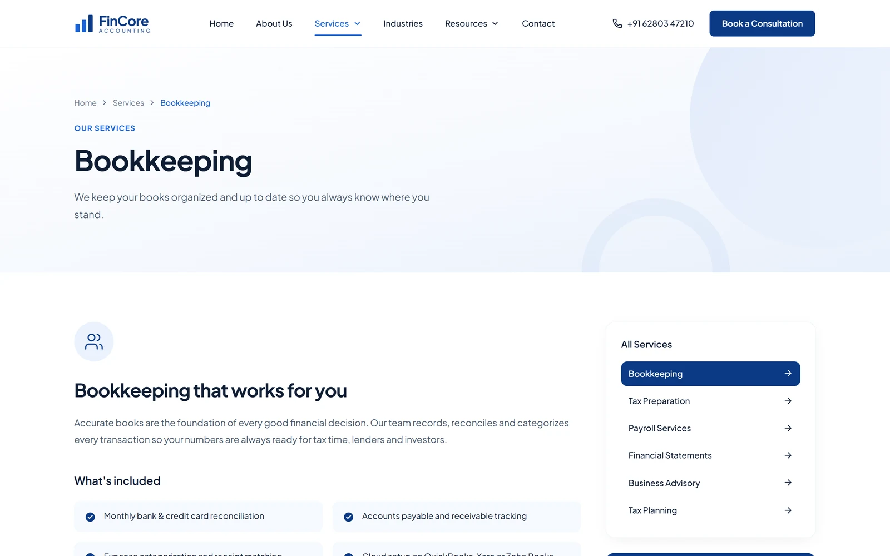

# FinCore Accounting — Accounting Firm Website Template

A professional multi-page website for an accounting, tax or bookkeeping firm, built with React 19, TypeScript, Vite, Tailwind CSS v4 and shadcn/ui. It includes six service pages, the industries you serve, a resources hub with articles, guides and FAQs, an about page with the team, and a contact page with a consultation form and map.

**[Live demo](https://fincore.codespanda.com/)** · **[Template page](https://codespanda.com/templates/fincore)** · **[Documentation](https://codespanda.com/templates/fincore/docs)**


## Features

- **10 routed pages** — Home, About, Services, a page per service, Industries, Resources, Contact, Privacy Policy, Terms and a 404 page.
- **Six services** — bookkeeping, tax preparation, payroll, financial statements, business advisory and tax planning, each with its own page: what's included, the process, a sidebar of all services and related services.
- **Industries** — eight industries served, from retail and SaaS to healthcare, real estate and hospitality.
- **Resources hub** — six articles with category tabs, four free guides and six FAQs.
- **About & team** — firm story, values, a timeline and a team of four.
- **Contact** — contact cards, a consultation form and an embedded Google Map.
- **Fully responsive**, with shadcn/ui components and a confident navy design.



## Tech stack

- React 19 and TypeScript
- [Vite](https://vitejs.dev) 8
- [Tailwind CSS v4](https://tailwindcss.com) and [shadcn/ui](https://ui.shadcn.com) on Base UI
- React Router 8
- [lucide-react](https://lucide.dev) icons; Plus Jakarta Sans and Geist fonts via Fontsource
- [Oxlint](https://oxc.rs) for linting

## Getting started

You need Node.js 20 or newer.

```bash
npm install
npm run dev
```

Open [http://localhost:5173](http://localhost:5173).

| Command | What it does |
| --- | --- |
| `npm run dev` | Start the Vite dev server |
| `npm run build` | Type-check and build the production site into `dist/` |
| `npm run preview` | Serve the built `dist/` folder locally |
| `npm run lint` | Lint the code with Oxlint |

## Project structure

```text
src/
  pages/            home, about, services, service-detail, industries, resources,
                    contact, legal (privacy & terms), not-found
  components/
    sections/       header, hero, benefits-bar, services, stats, why-choose-us,
                    testimonials, cta-banner, footer
    ui/             shadcn/ui primitives
    layout.tsx  logo.tsx  page-hero.tsx  section-heading.tsx  social-icons.tsx
  data/site.ts      Contact details, navigation, services, industries, team,
                    articles, guides and FAQs
  App.tsx           Routes
  index.css         Theme colors, fonts and Tailwind setup
```

## Make it your own

- **Content** — everything lives in `src/data/site.ts`: contact details, hours and map address, navigation, the six services and their page content, industries, team, articles, guides and FAQs. Service pages are generated from it.
- **Contact details** — replace the sample phone, email and address in `contact`. The address also drives the map on the contact page.
- **Photos** — team and article photos load from Unsplash URLs. Add your own to `public/` and point the entries in `site.ts` at them.
- **Colors and fonts** — edit the CSS variables in `:root` in `src/index.css` (the navy brand is `--primary: #0b3a86`). Tailwind and the shadcn/ui components pick them up.
- **Title and description** — edit `index.html`. Every page shares this title; for better SEO, give each page its own.
- **Contact form** — it shows a confirmation but doesn't send anything yet. Connect it to a form service, email API or CRM in `src/pages/contact.tsx`.


## Deployment

`npm run build` writes a static site to `dist/`.

**GitHub Pages** — `.github/workflows/deploy.yml` builds and deploys on every push to `main`, and copies `index.html` to `404.html` so deep links like `/services/bookkeeping` work.

1. In the repository, open **Settings → Pages** and set **Source** to **GitHub Actions**.
2. Push to `main`.
3. The site is served from a custom domain, so `vite.config.ts` uses `base: '/'`. To host it at `github.io/<repo>/` instead, set `base` to `'/<repo>/'`.

**Netlify, Vercel or Cloudflare Pages** — use build command `npm run build` and output folder `dist`, with a rewrite of all routes to `/index.html`.


## Credits

Designed and built by [CodesPanda](https://codespanda.com). Browse more free templates at [codespanda.com/templates](https://codespanda.com/templates).
